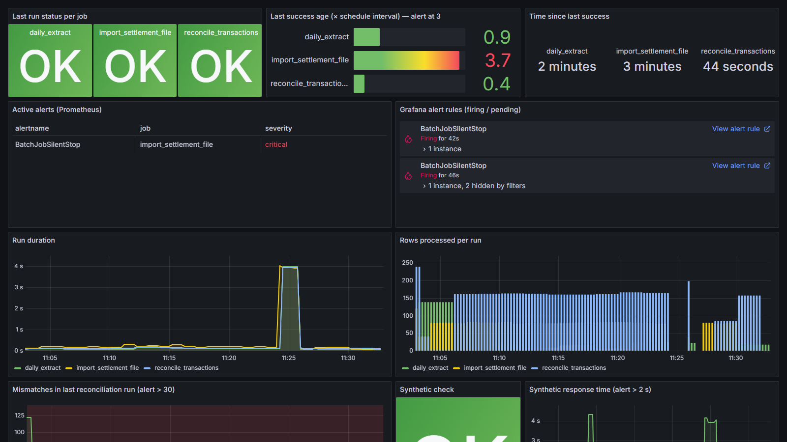
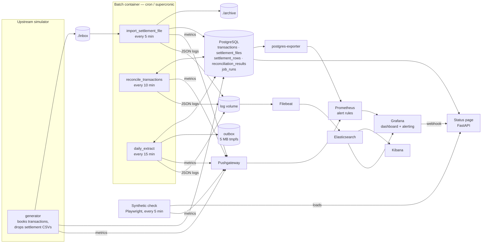
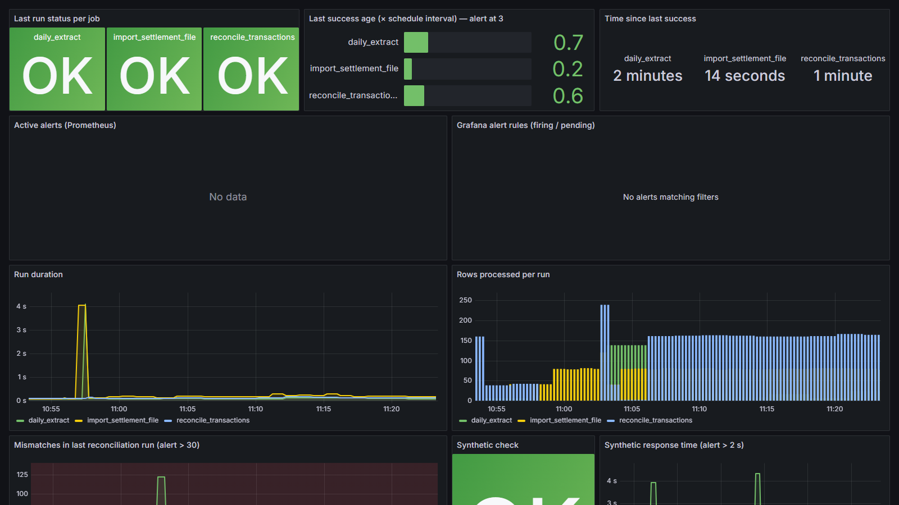
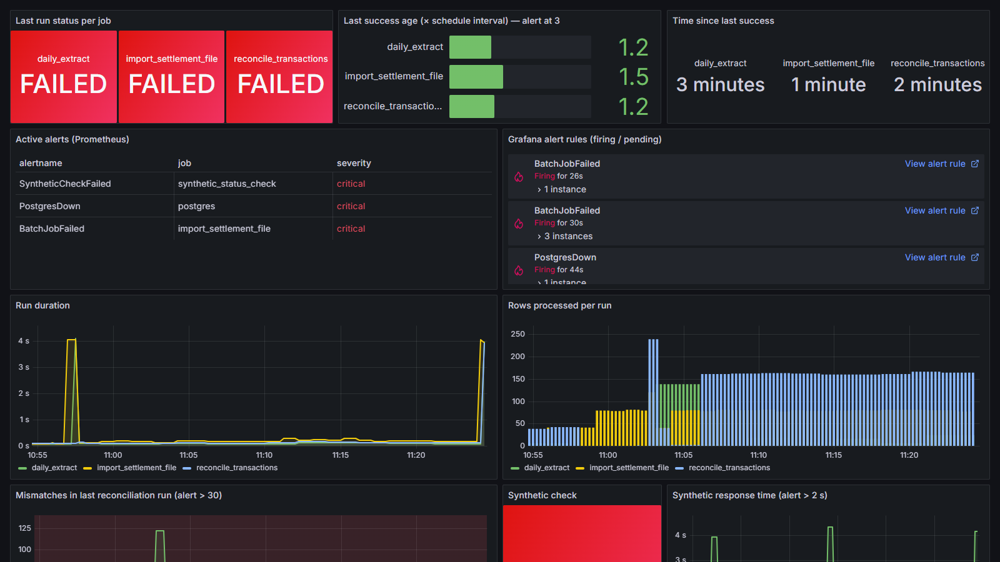
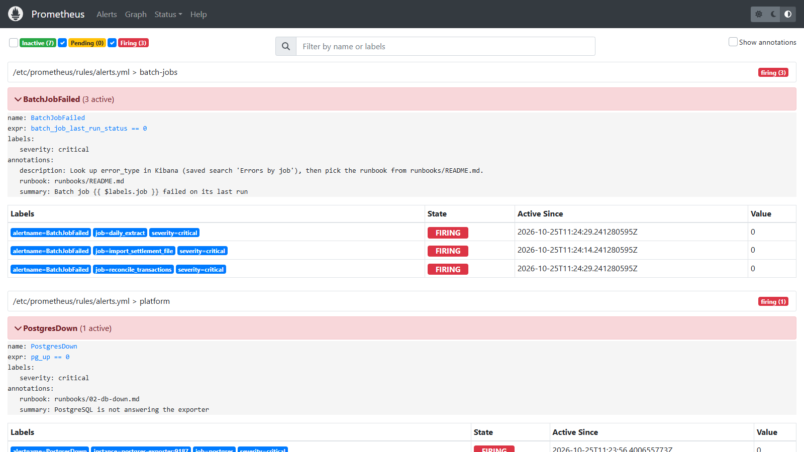
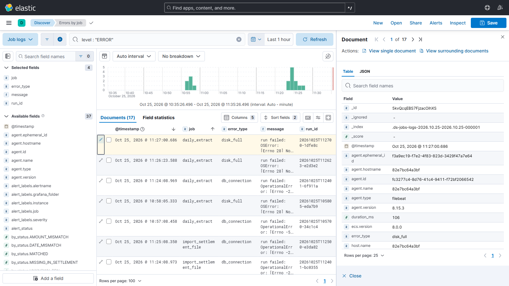
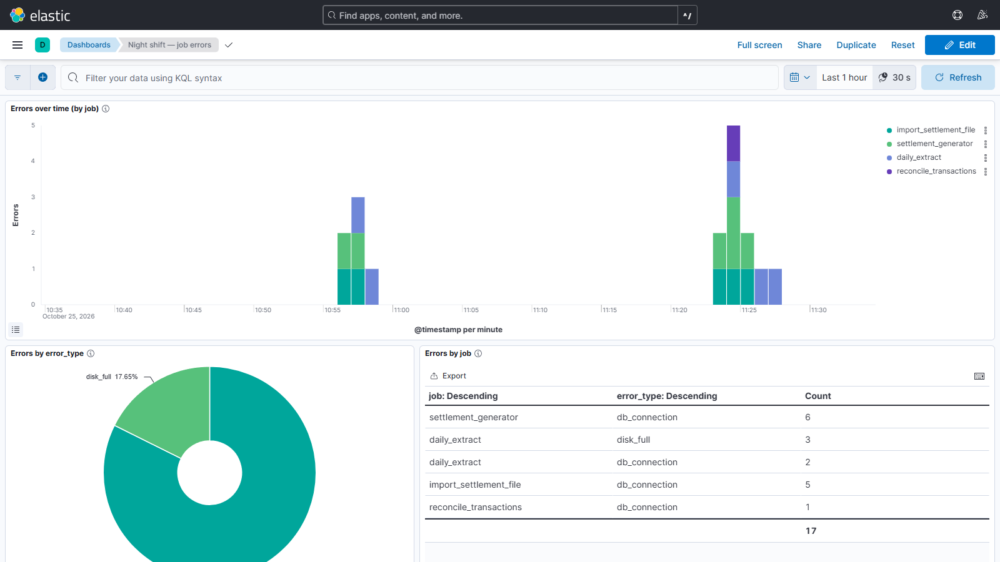
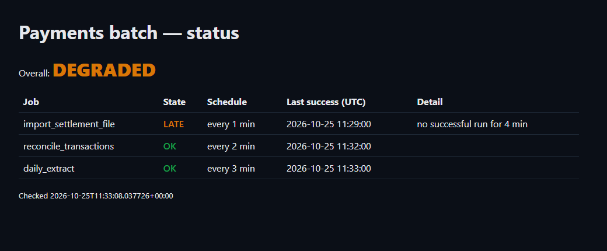
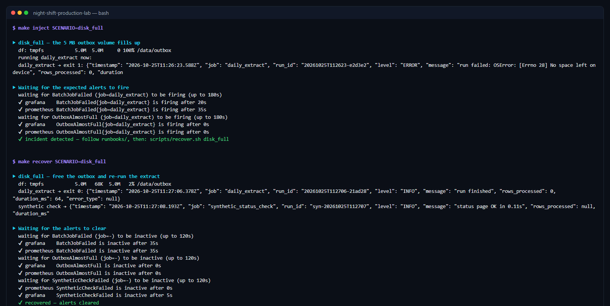

# night-shift-production-lab

[](https://github.com/Faissalelmo/night-shift-production-lab/actions/workflows/ci.yml)

A small, simulated payments back office that you run on a laptop, **monitor, break on purpose and
fix** — the way a night-shift IT production engineer works.

Batch jobs load settlement files, reconcile them against transactions and export the breaks. They
are scheduled with cron, log structured JSON, push metrics, and are watched by Prometheus, Grafana,
Elasticsearch/Kibana and a synthetic browser check. Seven incident scenarios can be injected with one
command; each has a runbook (in French), and one has a full post-mortem.

Everything is free, open-source, and starts with:

```bash
docker compose up -d
```

[](docs/demo.mp4)

▶ **[Watch the 2-minute demo](docs/demo.mp4)** (MP4, 1.9 MB): five incidents injected, detected and
recovered live, with the real script output on screen.

## Why this project

Night-shift production roles (*Ingénieur de Production IT – équipe de nuit*) ask for Linux, production
supervision, batch scheduling and monitoring, incident management and escalation, Grafana, Kibana,
and synthetic monitoring tools such as EKARA or Dynatrace. This lab practises those skills on a domain
I work with daily: reconciliation jobs on payment data.

It is built around the incident that hurts most at night: **the scheduled job that stops doing its
work without failing**. Monitoring that only watches for failures stays green while the morning's data
silently goes missing. Here, every job publishes *when it last did useful work*. The
`BatchJobSilentStop` alert fires when that age exceeds 3× the job's schedule. The scenario,
`missing_file`, has its own [runbook](runbooks/01-missing-file.md) and a
[post-mortem](postmortems/2026-10-silent-job-stop.md).

| Skill asked for | Where it is in the lab |
|---|---|
| Linux | Every runbook diagnoses with shell commands (`df -h`, `du`, `find -mmin`, `ps`, `grep`, `psql`, `pg_stat_activity`) — [cheat sheet](docs/linux-cheatsheet.md) |
| Batch scheduling and monitoring | 3 cron-scheduled jobs, run history in the database, per-job metrics and alerts |
| Supervision (Grafana / Prometheus) | Provisioned dashboard and 10 alert rules, defined in both Prometheus and Grafana alerting |
| Log analysis (Kibana) | Filebeat → Elasticsearch, saved search *Errors by job*, errors dashboard |
| Synthetic monitoring (EKARA-style) | Playwright opens the status page every 5 min, checks it shows `OK`, times it, alerts |
| APM (Dynatrace) | Covered by the same signals: duration, status, throughput and errors per job (Dynatrace is commercial, so it isn't used) |
| Incident management | Inject → detect → diagnose → escalate → recover → verify, for 7 scenarios; runbooks with escalation messages; a post-mortem |

## Architecture



| Component | Image (pinned) | Role |
|---|---|---|
| PostgreSQL | `postgres:16.4-alpine` | Synthetic payments data and job run history |
| Batch jobs | `python:3.12.7-slim` + supercronic v0.2.33 | The three jobs, scheduled by cron |
| Generator | same image | Simulated upstream: new transactions + a settlement CSV every 2 min |
| Pushgateway | `prom/pushgateway:v1.9.0` | Receives job metrics (with on-disk persistence) |
| Prometheus | `prom/prometheus:v2.54.1` | Scraping and alert rules |
| postgres-exporter | `postgres-exporter:v0.15.0` | `pg_up` and database metrics |
| Grafana | `grafana/grafana:11.2.2` | Provisioned datasources, dashboard, alert rules, contact point |
| Elasticsearch / Kibana / Filebeat | `8.15.3` | Job logs; saved objects imported automatically |
| Status page | `python:3.12.7-slim` + FastAPI | Job health from the database; `OK` / `DEGRADED` / `KO` |
| Synthetic check | `python:3.12.7-slim` + Playwright 1.47 (Chromium only) | Browser check of the status page |

## Run it

**Requirements:** Docker Desktop (Windows/macOS) or Docker Engine + Compose v2 (Linux), with
**at least 6 GB of memory allocated to Docker**, and about 8 GB of free disk for the images
(Elasticsearch and Kibana are ~2 GB each). The scripts need bash: on Windows use Git Bash.

```bash
git clone https://github.com/Faissalelmo/night-shift-production-lab.git
cd night-shift-production-lab
docker compose up -d                # or: make up   (also waits until everything is healthy)
```

The first start builds 3 images and pulls the rest (a few GB, 5–15 minutes depending on your connection). Kibana is the last
service to become ready, about 1–2 minutes after the others. On the first start, the jobs container seeds two days of
synthetic history and runs every job once, so the dashboards have data immediately.

**Production-like or demo timings.** The defaults follow the brief (import every 5 min, reconcile
every 10, extract every 15). To record a demo, use the fast profile, where every timer is about 5×
shorter:

```bash
cp .env.demo.example .env && docker compose up -d
```

Credentials and ports can be changed in `.env` (template: [`.env.example`](.env.example)). Without a
`.env`, the defaults below apply. All ports are bound to `127.0.0.1`.

### URLs and logins

| Service | URL | Login |
|---|---|---|
| Grafana — dashboard *Night Shift — Batch production* | http://localhost:3000 | `admin` / `admin` (or `GRAFANA_ADMIN_*` from `.env`) |
| Kibana — *Discover*, saved search *Errors by job*, dashboard *Night shift — job errors* | http://localhost:5601 | none (security disabled, local lab only) |
| Prometheus — alerts | http://localhost:9090/alerts | none |
| Pushgateway | http://localhost:9091 | none |
| Status page | http://localhost:8088 | none — `/health` returns the same verdict as JSON |
| Elasticsearch | http://localhost:9200 | none |
| PostgreSQL | `localhost:55432`, database `payments` | `lab` / `lab` (or `POSTGRES_*` from `.env`) |

### Make targets

`make` is optional: every target wraps a script in `scripts/`. On Windows, install it with
`choco install make`, or call the scripts directly from Git Bash.

| Command | What it does |
|---|---|
| `make up` / `make down` / `make clean` | Start and wait until healthy / stop / stop **and delete all data** |
| `make inject SCENARIO=<name>` | Break something, then wait until the expected alerts fire |
| `make recover SCENARIO=<name>` | Fix it, re-run the affected jobs, wait until the alerts clear |
| `make demo` | The 5 core scenarios back to back, with pauses (for a video) |
| `make verify` | All 7 scenarios; fails if any alert does not fire **and** clear |
| `make alerts` | Active alerts in Prometheus and Grafana |
| `make run JOB=daily_extract` | Run a job now |
| `make outbox` | Copy the outbox (a tmpfs inside the container) to `./outbox-copy` |

## The batch jobs

| Job | Schedule | Does | Idempotency |
|---|---|---|---|
| `import_settlement_file` | every 5 min | Loads every CSV from `./inbox` into PostgreSQL, then moves it to `./archive` | A file is recognised by name **and** SHA-256: a re-sent file is skipped with a WARNING and moved to `archive/rejected/`. Rows are inserted with `ON CONFLICT (rrn) DO NOTHING`. |
| `reconcile_transactions` | every 10 min | Matches transactions and settlement rows by RRN, then by amount and value date. Writes one verdict per RRN: `MATCHED`, `AMOUNT_MISMATCH`, `DATE_MISMATCH`, `UNKNOWN_RRN`, or `MISSING_IN_SETTLEMENT` (after a grace period) | `reconciliation_results.rrn` is unique. Late settlements re-qualify earlier `MISSING_IN_SETTLEMENT` results. |
| `daily_extract` | every 15 min ("daily", compressed) | Exports unexported mismatches to the outbox as CSV | Writes to a `.part` file, fsyncs it, renames it, and marks rows exported **in the same transaction**. A failed write exports nothing and loses nothing. |

Every job follows the same contract, implemented once in [`jobs/lab/runner.py`](jobs/lab/runner.py):

- **Structured JSON logs:** `timestamp, job, run_id, level, message, rows_processed, duration_ms, error_type`.
  They go to stdout and to the volume shipped by Filebeat.
- **Classified failures:** `error_type` is one of `db_connection`, `db_timeout`, `disk_full`,
  `bad_file_format`, `io_error`, `unexpected`. Warnings: `no_input_file`, `duplicate_file`,
  `overlapping_run`.
- **Non-zero exit code on failure.** A row is written to `job_runs` (read by the status page).
- **No overlapping runs:** a file lock per job. A cron run that finds the previous run still going
  skips with a WARNING.
- **Metrics pushed to the Pushgateway** (spec name → metric):
  - `last_success_timestamp` → `batch_job_last_success_timestamp_seconds`
  - `last_run_duration_seconds` → `batch_job_last_run_duration_seconds`
  - `rows_processed` → `batch_job_rows_processed`
  - `last_run_status` → `batch_job_last_run_status`
  - plus `batch_job_running`, `batch_job_last_start_timestamp_seconds` and
    `batch_job_schedule_interval_seconds`, which make the duration and silent-stop alerts generic.

**"Success" means the job did its work.** An import that finds an empty inbox exits 0, but it does
not refresh `last_success_timestamp`. That distinction is what makes a silent stop detectable.

## Alerts

Defined in [`prometheus/rules/alerts.yml`](prometheus/rules/alerts.yml) and mirrored as
Grafana-managed rules in [`grafana/provisioning/alerting/rules.yml`](grafana/provisioning/alerting/rules.yml).
Grafana sends notifications to a webhook on the status app, which logs them as JSON (visible in
Kibana as `job : "alert_notifications"`, level `ALERT`, so they don't inflate job error counts). The rules are unit-tested with `promtool test rules` in CI.

| Alert | Condition | Severity |
|---|---|---|
| `BatchJobFailed` | last run of a job failed | critical |
| `BatchJobTooSlow` | a run is taking (or took) longer than 2× the job's median duration over 6 h — 30 s floor so sub-second jobs don't alert on noise | warning |
| `BatchJobSilentStop` | no run **that did its work** for more than 3× the job's schedule interval | critical |
| `ReconciliationMismatchesHigh` | a reconciliation run in the last 5 min found more than 30 mismatches (an event: the next run overwrites the count, so the rule looks back 5 min) | warning |
| `OutboxAlmostFull` | outbox volume more than 90 % used | warning |
| `PostgresDown` | `pg_up == 0` | critical |
| `ScrapeTargetDown` | a Prometheus target is down for 1 min | warning |
| `SyntheticCheckFailed` | the status page did not show `OK` | critical |
| `SyntheticCheckSlow` | status page loaded, but took more than 2 s (a failed load is `SyntheticCheckFailed`, not both) | warning |
| `SyntheticCheckStale` | the synthetic check itself stopped running | warning |

## Incident scenarios

| Scenario | What breaks | Expected alerts | Runbook (FR) |
|---|---|---|---|
| `missing_file` | The generator stops; the import runs but has nothing to load | `BatchJobSilentStop` (import) after 3 intervals, then `SyntheticCheckFailed` | [01](runbooks/01-missing-file.md) |
| `db_down` | PostgreSQL is stopped; jobs fail with connection errors | `BatchJobFailed`, `PostgresDown`, `SyntheticCheckFailed` | [02](runbooks/02-db-down.md) |
| `disk_full` | The 5 MB outbox tmpfs is filled; the extract fails with `ENOSPC` | `BatchJobFailed` (extract), `OutboxAlmostFull` | [03](runbooks/03-disk-full.md) |
| `slow_query` | A `pg_sleep(120)` is injected into the reconciliation transaction | `BatchJobTooSlow` while it runs | [04](runbooks/04-slow-query.md) |
| `duplicate_rerun` | An archived file is dropped again, as-is and renamed | none: a WARNING, plus SQL proof that nothing was duplicated | [05](runbooks/05-duplicate-rerun.md) |
| `mismatch_spike` *(bonus)* | A settlement file with 120 wrong amounts | `ReconciliationMismatchesHigh` | [06](runbooks/06-mismatch-spike.md) |
| `slow_page` *(bonus)* | The status page takes 4 s | `SyntheticCheckSlow` | [07](runbooks/07-slow-page.md) |

```bash
make inject SCENARIO=db_down      # or: scripts/inject.sh db_down
#   … open Grafana, Kibana, the status page; follow runbooks/02-db-down.md …
make recover SCENARIO=db_down     # or: scripts/recover.sh db_down
```

`inject` waits until the expected alerts are firing in **both** Prometheus and Grafana, and `recover`
waits until they clear. Add `--no-wait` to the scripts to return immediately. `make verify` chains all
seven scenarios and prints a pass/fail summary:

```text
▶ Summary            (fast profile, fresh `docker compose down -v && up`, 16 GB Windows laptop)
  missing_file     PASS (293s)    BatchJobSilentStop fired 226 s (Grafana) / 241 s (Prometheus) after the generator stopped
  db_down          PASS (106s)    BatchJobFailed, PostgresDown, SyntheticCheckFailed within 25 s
  disk_full        PASS (86s)     BatchJobFailed + OutboxAlmostFull within 40 s
  slow_query       PASS (163s)    BatchJobTooSlow 40–60 s into the run, while it was still running
  duplicate_rerun  PASS (7s)      2 duplicate_file warnings, 0 duplicated RRNs
  mismatch_spike   PASS (358s)    fired within 35 s; clears by design 5 min after the spike
  slow_page        PASS (93s)     SyntheticCheckSlow within 35 s
```

On the production-like schedule (import every 5 min, no `.env`), `missing_file` was also measured:
`BatchJobSilentStop` fired **17 min 38 s** after the upstream stopped. That is 3 intervals plus the
wait for the next import run, against the 2 h 25 min of chance detection in the
[post-mortem](postmortems/2026-10-silent-job-stop.md) scenario.

## Repository layout

```
docker-compose.yml        the whole lab
jobs/                     batch image: runner, 3 jobs, generator, seed, alert tool, crontab entrypoint
status/                   FastAPI status page (+ Grafana webhook receiver)
synthetic/                Playwright synthetic check
db/init/                  schema
prometheus/               scrape config, alert rules, promtool unit tests
grafana/                  provisioned datasources, dashboard JSON, alert rules, contact point
filebeat/  kibana/        log shipping; saved objects + auto-import
scripts/                  inject / recover / verify / demo / wait-healthy
runbooks/                 one runbook per scenario (French)
postmortems/              example post-mortem (French)
docs/                     Linux cheat sheet (French), screenshots
```

## Screenshots

Taken on the running lab during the scenarios (fast profile).

| | |
|---|---|
|  |  |
| *Grafana — normal night* | *Grafana — `db_down`: jobs FAILED, PostgreSQL DOWN, alerts listed* |
|  |  |
| *`missing_file`: statuses still OK, last-success age in the red* | *Prometheus — firing alerts* |
|  |  |
| *Kibana — saved search "Errors by job"* | *Kibana — errors over time / by error_type / by job* |
|  |  |
| *Status page — DEGRADED* | *`make inject` / `make recover`: alerts fire, then clear* |

## Design notes and limits

- **Push model.** Batch jobs are short-lived, so they push to a Pushgateway (with persistence)
  instead of being scraped. The trade-off: a job that never starts pushes nothing. The silent-stop
  rule is written against the *last success timestamp* for that reason.
- **Security is off** for Elasticsearch and Kibana, and the default passwords are trivial. This is
  acceptable only because every port is bound to `127.0.0.1`. Don't expose this stack.
- **The outbox is a 5 MB tmpfs**, so `disk_full` can fill it without touching your disk. Its content
  is lost when the `jobs` container restarts; use `make outbox` to keep a copy.
- **Fault injection is explicit.** `slow_query` and `slow_page` read a `lab_faults` table, so nothing
  in the normal code path is faked.
- All data is synthetic: random RRNs, amounts and `INST00x` institution codes.

## CI

[`.github/workflows/ci.yml`](.github/workflows/ci.yml) runs on every push:
- `ruff check` and `ruff format --check`, plus shellcheck on every script;
- `docker compose config`, `promtool check config` and `promtool test rules`;
- checks that the dashboard JSON, the Kibana NDJSON and the provisioning YAML files parse.
